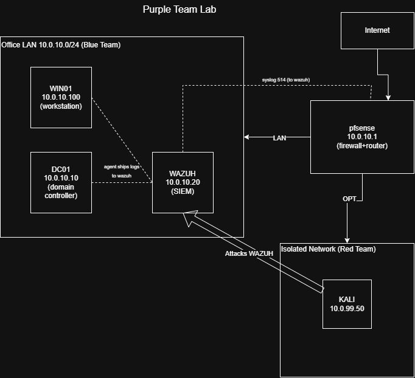

# PurpleTeamSOCLab
A VirtualBox lab simulation of an attack (Kali Linux) on an isolated network, with detection using a SIEM (Wazuh) and firewall (pfSense).

## OVERVIEW
This lab simulates an office network monitored by a SIEM, an attempted an SSH brute force attack on the SIEM server, the building of the log pipeline, and the collection of the logs.

## ARCHITECTURE
| Host   | Role                        | Network Segment | IP                          | Telemetry to SIEM |
|--------|-----------------------------|-----------------|-----------------------------|-------------------|
| pfSense | Firewall/router            | LAN, OPT1       | 10.0.10.1/24, 10.0.99.1/24  | syslog (514)      |
| DC01   | Domain controller (Windows) | LAN (Office)    | 10.0.10.10                  | agent (1514)      |
| WIN01  | Workstation (Windows 11)    | LAN (Office)    | DHCP                        | agent (1514)      |
| WAZUH  | SIEM (Ubuntu Server)        | LAN (Office)    | 10.0.10.20                  |                   |
| KALI   | Attacker                    | OPT1            | 10.0.99.50                  |                   |

## SKILLS
- SIEM setup and deployment
- Firewall deployment
- Isolated network creation
- Windows domain deployment
- Log pipeline setup
- Wrote log decoder and detection rules for Wazuh because it couldn't natively interpret pfSense logs
- Deployed Wazuh agents on Windows hosts
- Attack simulations: brute force attack on Wazuh server

## DETECTION FILES
Wazuh had to native decoder for the pfSense logs it was receiving, so it wasn't putting the logs into the SIEM dashboard. I wrote in the decoder and rules for Wazuh to interpret the pfSense logs here:\
 - [Decoder](DetectionFiles/local_decoder.xml)
 - [Rules](DetectionFiles/local_rules.xml)

